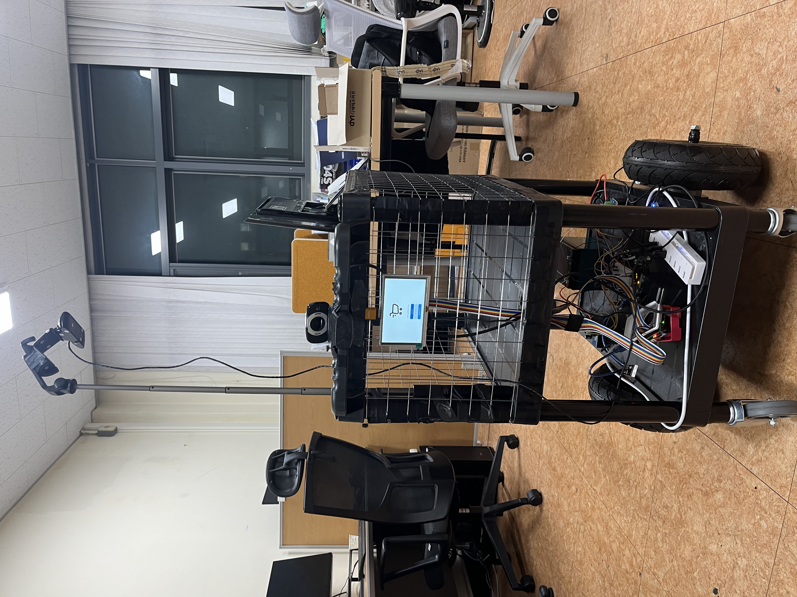
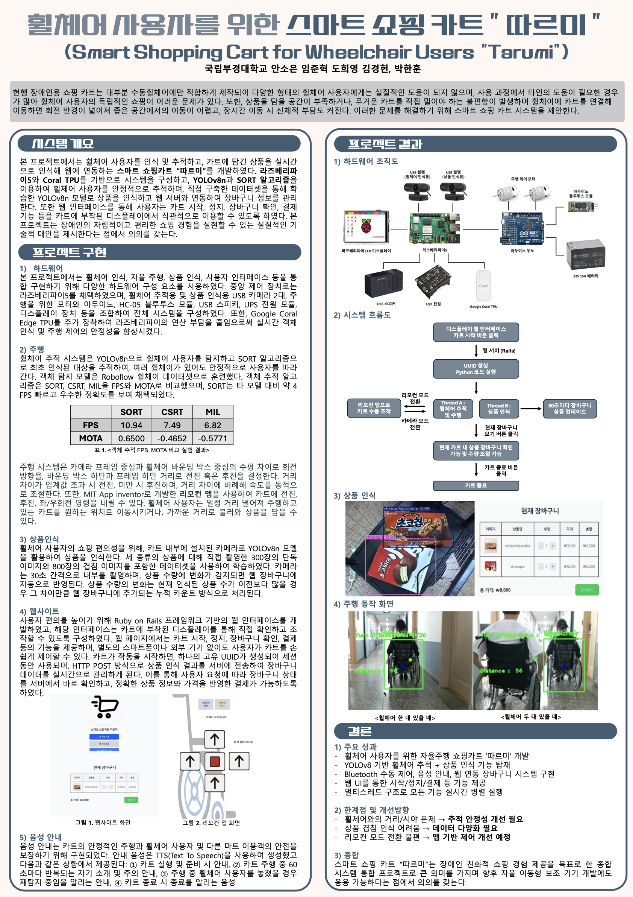

# 🛒 Tarumi (따르미)

### Smart Shopping Cart for Wheelchair Users

**Tarumi** is an embedded AI-based smart shopping cart prototype designed to improve shopping accessibility for wheelchair users.

The system integrates **wheelchair detection and tracking, autonomous cart following, product recognition, motor control, voice guidance, and a web-based shopping cart interface** on a Raspberry Pi 5-based embedded platform.

<p align="center">
  
</p>

<p align="center">
  <b>Tarumi Smart Shopping Cart Prototype</b>
</p>

<p align="center">
  <a href="https://www.youtube.com/watch?v=UA5QTQOUaPA">🎥 Watch Demo</a>
  &nbsp;&nbsp;•&nbsp;&nbsp;
  <a href="https://github.com/augustinus2000/Tarumi-kartweb">🖥️ Web Application</a>
  &nbsp;&nbsp;•&nbsp;&nbsp;
  <a href="docs/images/poster.pdf">📄 Project Poster</a>
</p>

---

## 📄 Publication

### Smart Shopping Cart for Wheelchair Users "Tarumi"

**Soeun An, Gyeongheon Kim, Heeyoung Do, Junhyeok Im, Hanhoon Park**

*2025 IEMEK ICT College Student Paper Competition*
*대한임베디드공학회 ICT 대학생 논문경진대회*

**Proceedings of the IEMEK ICT College Student Paper Competition, pp. 112–114, June 2025**

🏆 **Outstanding Paper Presentation Award (우수 논문 발표상)**

### Abstract

> This paper presents a smart shopping cart system designed to assist wheelchair users. The system features autonomous tracking of wheelchair users and recognition of purchased products placed in the cart. The tracking and recognition is based on the YOLOv8n object detection model, and the SORT tracking algorithm is used together to ensure stable tracking of the user. The hardware platform includes a Raspberry Pi 5, Arduino, motor drivers, and cameras for real-time image processing and control. A custom dataset is created to improve the accuracy of product recognition, which includes images taken under challenging scenarios such as occlusion. Recognized product information is sent via HTTP POST to a Ruby on Rails-based web server, being automatically stored in the user's online shopping cart. In addition, the system provides voice guidance using TTS and supports manual cart operation through a smartphone-based remote control application. The system demonstrates a practical application of embedded systems to improve shopping accessibility for wheelchair users.

**Keywords:** Smart shopping cart, YOLO, SORT, Raspberry Pi 5, Object tracking

---

## 🖼️ Project Poster

<p align="center">
  <a href="docs/images/poster.pdf">
    
  </a>
</p>

<p align="center">
  <a href="docs/images/poster.pdf"><b>View Full Poster (PDF)</b></a>
</p>

---

## 🎥 System Demonstration

The complete Tarumi prototype, including autonomous wheelchair following, product recognition, and the integrated shopping interface, can be seen in the demonstration video.

<p align="center">
  <a href="https://www.youtube.com/watch?v=UA5QTQOUaPA">
    <b>▶ Watch the Tarumi System Demonstration on YouTube</b>
  </a>
</p>

---

## 📌 Overview

Tarumi was developed as an integrated smart shopping cart system for wheelchair users.

The complete prototype combines:

- **Wheelchair detection and tracking** using YOLOv8n and SORT
- **Autonomous cart following** based on the tracked user's position
- **Product recognition** using a separately trained YOLO model
- **Raspberry Pi 5-based embedded computing**
- **Arduino-based motor control**
- **Voice guidance** for system status and safety notifications
- **Automatic shopping-cart updates** through HTTP communication
- **Ruby on Rails-based shopping interface**
- **Touchscreen-based user interaction**

The original prototype also supported manual cart operation through a smartphone application using Bluetooth communication with the Arduino.

This repository contains the **computer vision, autonomous control, and embedded motor-control components** of the Tarumi system.

The web application is maintained separately:

### 🖥️ [Tarumi Web Application — Tarumi-kartweb](https://github.com/augustinus2000/Tarumi-kartweb)

---

## 🏗️ System Architecture

The complete Tarumi system integrates the embedded vision pipeline in this repository with the separate Rails web application.

```text
                          ┌─────────────────────┐
                          │    Raspberry Pi 5   │
                          └──────────┬──────────┘
                                     │
                   ┌─────────────────┴─────────────────┐
                   │                                   │
                   ▼                                   ▼
          Wheelchair Camera                     Product Camera
                   │                                   │
                   ▼                                   ▼
              YOLOv8n                           YOLO Detector
                   │                                   │
                   ▼                                   │
             SORT Tracking                            │
                   │                                   │
                   ▼                                   │
           Motion Decision                            │
                   │                                   │
                   │ USB Serial                        │ HTTP POST
                   ▼                                   ▼
              ┌─────────┐                    ┌──────────────────┐
              │ Arduino │                    │ Ruby on Rails Web│
              └────┬────┘                    │   Application    │
                   │                         └────────┬─────────┘
                   ▼                                  │
            Motor Controller                          ▼
                   │                           Shopping Cart UI
                   ▼                                  │
                Motors                                ▼
                                               Raspberry Pi
                                                Touch Display
```

The two software repositories correspond to the two main parts of this architecture:

| Component | Repository |
|---|---|
| Vision, tracking & embedded control | **Tarumi** (this repository) |
| Shopping cart & web interface | **[Tarumi-kartweb](https://github.com/augustinus2000/Tarumi-kartweb)** |

---

## 👁️ Wheelchair Detection and Tracking

Tarumi uses a **YOLOv8n-based object detector** to detect wheelchair users in real time.

After detection, **SORT (Simple Online and Realtime Tracking)** maintains the identity of the initially selected wheelchair user across consecutive frames.

The tracked bounding box is used to estimate the relative position of the user and determine the movement of the cart.

The autonomous control system supports:

- Forward movement
- Backward movement
- Left and right turning
- Combined forward/backward turning
- Automatic stopping
- User re-detection guidance when tracking is interrupted

The main wheelchair-tracking and control pipeline is implemented in:

```text
sort_coral_tpu.py
```

The SORT implementation is contained in:

```text
short.py
```

---

## 🍪 Product Recognition

A second camera installed inside the cart monitors products placed by the user.

A separately trained YOLO model performs product recognition. The runtime compares the currently detected products with the previous state and transmits updated information when the contents of the cart change.

The recognition pipeline sends the detected products together with the active cart UUID to the Rails application through:

```text
POST /cart/yolo_detect
```

Conceptually, the integration works as follows:

```text
Product Camera
      │
      ▼
 YOLO Detection
      │
      ▼
Detected Products
      │
      │  HTTP POST
      ▼
Tarumi-kartweb
      │
      ▼
Find Active Cart by UUID
      │
      ▼
Update Cart Items
      │
      ▼
Shopping Cart Interface
```

The corresponding server-side implementation and user interface are available in the **[Tarumi-kartweb repository](https://github.com/augustinus2000/Tarumi-kartweb)**.

---

## ⚙️ Motor Control

The Raspberry Pi communicates with the Arduino through **USB serial communication at 9600 baud**.

Motion commands use the following format:

```text
<command>,<speed>
```

For example:

```text
f,100
s,0
```

The Arduino firmware supports:

| Command | Motion |
|:---:|---|
| `f` | Forward |
| `b` | Backward |
| `l` | Turn left |
| `r` | Turn right |
| `s` | Stop |
| `z` | Forward-left |
| `x` | Forward-right |
| `c` | Backward-left |
| `v` | Backward-right |

The firmware is located at:

```text
arduino/tarumi_motor_controller/tarumi_motor_controller.ino
```

The firmware receives commands from the Raspberry Pi over USB serial and converts them into PWM signals for the motor controller.

---

## 🔊 Voice Guidance

Tarumi provides audio guidance during operation.

The included audio files are used for events such as:

- System startup
- Ready state
- User detection/re-detection
- Periodic safety notifications
- System shutdown

The audio resources are located in:

```text
sounds/
```

---

## 📱 Manual Control

The complete Tarumi prototype also supported manual cart operation through a smartphone application connected to the Arduino via Bluetooth.

This functionality is shown as part of the original system design and project materials.

However, the original Bluetooth remote-control application and its corresponding Arduino firmware are **not included in this repository**.

The Arduino firmware preserved here implements the **USB serial interface used between the Raspberry Pi and Arduino during autonomous operation**.

---

## 🖥️ Web Application

The user-facing component of Tarumi was implemented as a separate Ruby on Rails application.

### [Tarumi-kartweb](https://github.com/augustinus2000/Tarumi-kartweb)

The web application provides:

- UUID-based shopping cart sessions
- Product-recognition API integration
- Automatic registration of detected products
- Product quantity management
- Product image and price display
- Automatic subtotal and total-price calculation
- Shopping cart and payment interfaces
- Raspberry Pi display-oriented UI
- Controls for starting and stopping the external detection process

The embedded runtime in this repository and the Rails application communicate through the local network interface:

```text
Tarumi Vision Pipeline
        │
        │ POST /cart/yolo_detect
        ▼
Tarumi-kartweb
        │
        ▼
Shopping Cart Database
        │
        ▼
Touchscreen Interface
```

---

## 📂 Repository Structure

```text
Tarumi/
├── sort_coral_tpu.py
├── short.py
├── requirements.txt
│
├── best_full_integer_quant_edgetpu.tflite
├── best_kgh.pt
│
├── arduino/
│   └── tarumi_motor_controller/
│       └── tarumi_motor_controller.ino
│
├── sounds/
│   ├── intro.mp3
│   ├── ready.mp3
│   ├── detection.mp3
│   ├── warning.mp3
│   └── close.mp3
│
└── docs/
    └── images/
        ├── tarumi.jpg
        ├── poster.png
        └── poster.pdf
```

### Main Files

| File | Description |
|---|---|
| `sort_coral_tpu.py` | Main Raspberry Pi runtime for wheelchair tracking, autonomous control, product recognition, server communication, and voice guidance |
| `short.py` | SORT tracking implementation |
| `best_full_integer_quant_edgetpu.tflite` | Quantized model used for wheelchair detection |
| `best_kgh.pt` | YOLO model used for product recognition |
| `tarumi_motor_controller.ino` | Arduino firmware for autonomous motor control |
| `requirements.txt` | Python dependencies |

---

## 🛠️ Requirements

### Hardware

The complete prototype was built around:

- Raspberry Pi 5
- Arduino
- USB cameras
- Motor drivers and DC motors
- Google Coral TPU
- Raspberry Pi display
- Speaker/audio output

### Python Dependencies

Install the required Python packages with:

```bash
pip install -r requirements.txt
```

The current Python dependencies are:

```text
filterpy
numpy
opencv-python
pygame
pyserial
requests
ultralytics
```

> **Note**
>
> Tarumi is a hardware-dependent embedded system. Running the complete system requires the corresponding Raspberry Pi, cameras, Arduino, motor-control hardware, model files, and the associated web application.

---

## 🚀 Usage

The main runtime requires a cart UUID corresponding to the active shopping session:

```bash
python3 sort_coral_tpu.py <cart_uuid>
```

For example:

```bash
python3 sort_coral_tpu.py 1234
```

Debug visualization can be enabled with:

```bash
python3 sort_coral_tpu.py 1234 --debug
```

The current runtime is configured for:

| Component | Configuration |
|---|---|
| Wheelchair camera | Camera index `0` |
| Product camera | Camera index `2` |
| Arduino serial port | `/dev/ttyACM0` |
| Serial baud rate | `9600` |
| Tarumi web server | `http://localhost:3000` |

These values reflect the original project configuration and may need to be adjusted for a different hardware environment.

For the complete shopping interface and Rails setup, see:

### ➜ [Tarumi-kartweb — Web Application Repository](https://github.com/augustinus2000/Tarumi-kartweb)

---

## 🔗 Project Components

Tarumi is preserved across two repositories:

### 🤖 Embedded AI & Autonomous Control

**Tarumi — this repository**

Wheelchair detection, SORT tracking, autonomous movement, product recognition, Arduino communication, and voice guidance.

### 🖥️ Web Application

**[Tarumi-kartweb](https://github.com/augustinus2000/Tarumi-kartweb)**

Ruby on Rails backend and touchscreen interface for shopping-cart sessions, detected products, quantities, prices, and payment flow.

### 🎥 Demonstration

**[Watch the complete Tarumi prototype on YouTube](https://www.youtube.com/watch?v=UA5QTQOUaPA)**

---

## 📜 Project Note

This repository preserves the embedded AI and autonomous-control components developed for the original Tarumi academic prototype.

Legacy experiments and intermediate development files have been removed to make the final system structure easier to understand, while the core runtime, trained models, Arduino firmware, audio resources, publication poster, and integration with the Tarumi web application are preserved.

---

## 🙏 Acknowledgements

This project was developed at the **Department of Electronic Engineering, Pukyong National University**.
